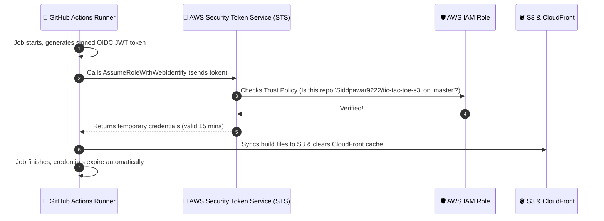

# 🧠 DevOps & Cloud Architecture: Concepts Explained

This guide explains every cloud and DevOps concept used in this project. Each section covers **what** a tool/service does, **why** we chose it, and **how** it works in this architecture — written in simple, clear English for anyone to understand.

---

## 📑 Table of Contents

1. [What Problem Are We Solving?](#1-what-problem-are-we-solving)
2. [Infrastructure as Code (IaC) & Terraform](#2-infrastructure-as-code-iac--terraform)
3. [Terraform State & Native S3 Locking](#3-terraform-state--native-s3-locking)
4. [DNS, BigRock & AWS Route 53](#4-dns-bigrock--aws-route-53)
   - [Why Did We Split Deployment into Two Phases?](#why-did-we-split-deployment-into-two-phases)
5. [SSL/TLS Certificates & AWS ACM](#5-ssltls-certificates--aws-acm)
   - [Why Does the Certificate Have to Live in `us-east-1`?](#why-does-the-certificate-have-to-live-in-us-east-1)
6. [Amazon S3: Private Static Asset Hosting](#6-amazon-s3-private-static-asset-hosting)
7. [Amazon CloudFront (CDN) & Origin Access Control (OAC)](#7-amazon-cloudfront-cdn--origin-access-control-oac)
8. [Single Page Application (SPA) Routing & Error Rewriting](#8-single-page-application-spa-routing--error-rewriting)
9. [Keyless CI/CD: GitHub Actions with OIDC](#9-keyless-cicd-github-actions-with-oidc)
10. [Summary Cheat Sheet](#10-summary-cheat-sheet)

---

## 1. What Problem Are We Solving?

When you build a modern React application, running `npm run build` produces static files: HTML, CSS, JavaScript, and images.

To make this website available worldwide, fast, and secure:
- ❌ **Traditional Approach:** Rent an expensive Linux EC2 server, install Nginx, set up SSL with Certbot, open firewall ports, and maintain OS patches.
- ✅ **Serverless Cloud Approach:** Store static files in Amazon S3, deliver them globally via CloudFront CDN, secure them with free AWS ACM SSL, and let Terraform configure everything automatically in minutes.

---

## 2. Infrastructure as Code (IaC) & Terraform

### What is Infrastructure as Code?

In a traditional workflow, a developer or DevOps engineer logs into the AWS Management Console (web UI), clicks through dozens of screens, and manually creates resources like S3 buckets, CloudFront distributions, and IAM roles. This approach has serious problems:

- **Human error:** You might miss a security setting, misconfigure a permission, or forget a step.
- **No version control:** There is no record of what was changed, when, or by whom.
- **Not repeatable:** Recreating the exact same environment (e.g., for staging or disaster recovery) is nearly impossible.

**Infrastructure as Code (IaC)** solves all of these problems. Instead of clicking buttons, you describe your entire infrastructure in declarative configuration files (`.tf` files). Terraform reads these files, compares them against the current state of your cloud, and creates, updates, or deletes resources to match your desired configuration.

### How Terraform Works:

```
terraform init    → Downloads provider plugins (e.g., AWS provider).
terraform plan    → Shows a preview of what will be created, changed, or destroyed.
terraform apply   → Actually provisions the resources in AWS.
terraform destroy → Tears down all managed resources.
```

### Why We Use Terraform Modules:

In production codebases, putting all infrastructure code into a single file becomes hard to maintain, test, and reuse. **Modules** are self-contained, reusable packages of Terraform configuration that encapsulate a specific piece of infrastructure:

| Module | Responsibility |
| :--- | :--- |
| `modules/route53` | Creates and manages the DNS hosted zone |
| `modules/acm` | Requests and validates SSL/TLS certificates |
| `modules/s3` | Provisions and secures the static asset bucket |
| `modules/cloudfront` | Configures the CDN distribution with OAC and DNS alias records |
| `modules/oidc` | Sets up the IAM OIDC provider and least-privilege deployment role |

Each module has its own `variables.tf` (inputs), `main.tf` (resources), and `outputs.tf` (exported values). The root environment (`environments/prod/infra/main.tf`) wires these modules together by passing outputs from one module as inputs to another.

---

## 3. Terraform State & Native S3 Locking

### What is Terraform State?

Terraform maintains a **state file** (`terraform.tfstate`) — a JSON document that records the mapping between the resources defined in your `.tf` files and the real resources that exist in AWS. For example, it records that the S3 bucket resource named `aws_s3_bucket.this` in your code corresponds to the actual bucket `geekysiddhesh-shop-prod-site` in your AWS account.

Without the state file, Terraform would have no way to know:
- Which resources it previously created.
- Whether a resource needs to be updated or recreated.
- Which resources to delete during `terraform destroy`.

### Why Remote State in S3?

By default, Terraform stores the state file on your local machine. This is problematic for teams because:
- If your laptop crashes, you lose the state file and Terraform "forgets" about all the resources it created.
- Two team members running `terraform apply` simultaneously can corrupt the state.

We store the state file in an **encrypted S3 bucket** (`react-tfstate-siddhesh-9821`) so that:
1. **Durability:** S3 provides 99.999999999% (11 nines) data durability. The state file is safe even if your local machine is lost.
2. **Shared access:** Any authorized team member can run Terraform from any machine.
3. **Encryption at rest:** The state file (which may contain sensitive resource metadata) is encrypted using AES-256.

### Native S3 Locking (`use_lockfile = true`)

When someone runs `terraform apply`, Terraform creates a `.tflock` lock file in S3 using conditional writes. If a second person tries to run `terraform apply` at the same time, S3 rejects the second lock attempt and Terraform exits with a clear error: *"State is locked by another process."*

This is a native feature in Terraform >= 1.10, which means we **do not need a separate DynamoDB table** for locking — which was required in older Terraform versions.

---

## 4. DNS, BigRock & AWS Route 53

### What is DNS?

**DNS (Domain Name System)** is the system that translates human-readable domain names (like `geekysiddhesh.shop`) into machine-readable IP addresses (like `13.249.98.54`). Every time a user types your website URL into their browser, a DNS lookup happens behind the scenes to find the correct server.

### Key Terms:

| Term | What It Means |
| :--- | :--- |
| **Domain Registrar (BigRock)** | The company where you purchased your domain name. BigRock holds the authoritative registration record for `geekysiddhesh.shop` and lets you configure which NameServers the internet should query for DNS records. |
| **Hosted Zone (Route 53)** | A container in AWS Route 53 that holds DNS records (A, AAAA, CNAME, NS, SOA, etc.) for your domain. When someone looks up `geekysiddhesh.shop`, the request is routed to Route 53's hosted zone which responds with the correct IP/alias. |
| **NameServers (NS records)** | The 4 servers (e.g., `ns-616.awsdns-13.net`) that are authoritative for answering DNS queries about your domain. By updating these in BigRock to point to Route 53's nameservers, you delegate DNS management to AWS. |

### Why Did We Split Deployment into Two Phases?

When Terraform creates a Route 53 hosted zone, AWS assigns 4 new NameServers. But until you manually update these NameServers in BigRock, the internet still queries BigRock's old servers — which know nothing about AWS.

**The Problem with a Single-Phase Deploy:**
1. Terraform creates the Route 53 hosted zone → gets 4 AWS NameServers.
2. Terraform immediately requests an ACM SSL certificate with DNS validation.
3. ACM places a CNAME validation record inside Route 53.
4. ACM asks the public internet to verify that CNAME record.
5. The internet queries BigRock's old NameServers (not yet updated) → record not found → **validation fails → Terraform hangs indefinitely**.

**The Two-Phase Solution:**
- **Phase 1 (`environments/prod/dns`):** Creates only the Route 53 hosted zone. Terraform outputs the 4 NameServers. You log into BigRock and update the NS records manually, then wait 30–60 minutes for DNS propagation.
- **Phase 2 (`environments/prod/infra`):** Now that the internet routes `geekysiddhesh.shop` queries to Route 53, Terraform creates ACM, S3, CloudFront, and OIDC. The ACM DNS validation succeeds within minutes because Route 53 is now authoritative.

This separation is a standard industry practice when DNS is managed by an external registrar.

---

## 5. SSL/TLS Certificates & AWS ACM

### What is SSL/TLS?

**SSL/TLS (Secure Sockets Layer / Transport Layer Security)** is the encryption protocol that secures data in transit between a user's browser and your web server. When your browser shows `https://` with a padlock icon, it means:
1. The connection is **encrypted** — no one on the same network can intercept or read the data.
2. The server's **identity is verified** — the certificate proves that `geekysiddhesh.shop` is served by the legitimate owner, not an impersonator.

### How ACM Works:

**AWS Certificate Manager (ACM)** is a managed service that provides free, automatically renewing SSL/TLS certificates. Here is the flow:

1. **Certificate Request:** Terraform requests a certificate for `geekysiddhesh.shop` and `www.geekysiddhesh.shop` using DNS validation.
2. **DNS Validation:** ACM generates a unique CNAME record (e.g., `_abc123.geekysiddhesh.shop → _xyz789.acm-validations.aws`). Terraform automatically creates this record in Route 53.
3. **Ownership Proof:** ACM queries the public DNS for that CNAME record. If it finds it, ACM confirms you own the domain and **issues** the certificate.
4. **Auto-Renewal:** ACM automatically renews the certificate before expiry (every 13 months) as long as the DNS validation record exists.

### Why Does the Certificate Have to Live in `us-east-1`?

CloudFront is a **globally distributed** service — it does not belong to any single AWS region. However, AWS internally requires that all certificates used by CloudFront distributions **must be provisioned in the `us-east-1` (N. Virginia) region**. This is an AWS architectural constraint, not a user choice.

In our Terraform code, we handle this by defining a separate AWS provider alias (`aws.us_east_1`) and passing it explicitly to the ACM module:

```hcl
module "acm" {
  providers = { aws = aws.us_east_1 }
  ...
}
```

---

## 6. Amazon S3: Private Static Asset Hosting

### What is Amazon S3?

**Amazon S3 (Simple Storage Service)** is an object storage service that stores files (called "objects") in containers (called "buckets"). It provides 99.999999999% durability, meaning your files are virtually guaranteed to never be lost.

In this project, the S3 bucket `geekysiddhesh-shop-prod-site` stores the React build output — `index.html`, CSS files, JavaScript bundles, images, and fonts.

### Why is Our Bucket Completely Private?

Many older tutorials and blog posts enable **S3 Static Website Hosting** and make the entire bucket publicly accessible. This is a significant security risk in production:

| Risk with Public S3 | Impact |
| :--- | :--- |
| Direct object access | Anyone can download your files by guessing or enumerating URLs |
| Bandwidth abuse | Attackers can hotlink your files, causing high data transfer costs |
| No access logging control | Harder to track who accessed what and when |

**Our approach** follows AWS security best practices:
- **All public access is blocked** at the bucket level using `aws_s3_bucket_public_access_block` with all 4 flags set to `true`.
- **No S3 Static Website Hosting** is enabled — CloudFront serves the files instead.
- **Only CloudFront can read** from the bucket, enforced through a bucket policy that checks the CloudFront distribution's ARN via Origin Access Control (OAC).

---

## 7. Amazon CloudFront (CDN) & Origin Access Control (OAC)

### What is a CDN?

A **Content Delivery Network (CDN)** is a globally distributed network of servers (called **edge locations**) that cache and serve content to users from the nearest geographic location.

Without a CDN, every user in the world would fetch files from a single S3 bucket in `ap-south-1` (Mumbai). A user in Europe or the US would experience higher latency due to the physical distance.

**Amazon CloudFront** operates 400+ edge locations across 90+ cities worldwide. Here is what happens when a user visits `geekysiddhesh.shop`:

1. The browser resolves `geekysiddhesh.shop` → Route 53 returns the CloudFront distribution's domain.
2. The request is routed to the **nearest CloudFront edge location** (e.g., Frankfurt for a European user).
3. **Cache HIT:** If the edge already has the file cached, it returns it immediately (~5–20ms latency).
4. **Cache MISS:** If not cached, CloudFront fetches the file from the S3 origin in Mumbai, caches it at the edge, and returns it to the user. Subsequent requests from the same region are served from cache.

### What is Origin Access Control (OAC)?

OAC is the modern AWS mechanism (successor to OAI — Origin Access Identity) that securely connects CloudFront to a private S3 bucket. Here is how it works:

1. When CloudFront needs to fetch a file from S3, it **signs the request** using AWS Signature Version 4 (SigV4).
2. The S3 bucket policy contains a condition that checks:
   - Is the request from `cloudfront.amazonaws.com`?
   - Does the `AWS:SourceArn` match this specific CloudFront distribution's ARN?
3. If both conditions pass → S3 returns the file. Otherwise → S3 returns `403 Forbidden`.

This ensures that **no one can bypass CloudFront** and access S3 directly, even if they know the bucket name.

---

## 8. Single Page Application (SPA) Routing & Error Rewriting

### The Problem with SPAs on S3

In a React Single Page Application, there is only **one real HTML file**: `index.html`. All other "pages" like `/game`, `/leaderboard`, or `/settings` are handled by **client-side JavaScript routing** (React Router). These routes do not correspond to actual files on the server.

When a user:
1. Visits `https://geekysiddhesh.shop` → CloudFront serves `index.html` (the default root object) → React Router renders the home page. ✅
2. Clicks a link to `/game` → React Router updates the URL in the browser **without a server request** → renders the game page. ✅
3. **Refreshes the page** at `/game` or directly types `https://geekysiddhesh.shop/game` in the browser → CloudFront asks S3 for a file named `game` → **S3 returns 403/404** because no such file exists. ❌

### The CloudFront Fix: Custom Error Responses

We configured CloudFront to intercept `403 Forbidden` and `404 Not Found` responses from S3 and rewrite them:

```text
S3 returns 403 or 404
  → CloudFront responds with /index.html and HTTP status 200 OK
  → React loads in the browser
  → React Router reads the URL (/game) and renders the correct page
```

This is configured in `modules/cloudfront/main.tf`:
```hcl
custom_error_response {
  error_code         = 403
  response_code      = 200
  response_page_path = "/index.html"
}
```

This is the standard approach for hosting SPAs on S3 + CloudFront, and it ensures that deep links, page refreshes, and bookmarks all work correctly.

---

## 9. Keyless CI/CD: GitHub Actions with OIDC

### The Problem with Static AWS Keys

In a traditional CI/CD setup, you store long-lived AWS credentials (`AWS_ACCESS_KEY_ID` and `AWS_SECRET_ACCESS_KEY`) as GitHub repository secrets. These keys have serious risks:
- **No expiry:** They remain valid until manually rotated or deleted.
- **Broad exposure:** Anyone with repository admin access can view or copy them.
- **Leak risk:** If your repository is accidentally made public, or if secrets are logged in CI output, the keys are compromised.
- **Compliance violations:** Industry standards like SOC 2 and ISO 27001 discourage long-lived credentials in CI/CD pipelines.

### What is OIDC (OpenID Connect)?

**OIDC** is an identity verification protocol that allows one service (GitHub Actions) to prove its identity to another service (AWS) without sharing any permanent credentials. Instead, GitHub generates a **short-lived, signed JWT (JSON Web Token)** for each workflow run that contains claims like:
- **Who:** `repo:Siddpawar9222/tic-tac-toe-s3`
- **What branch:** `ref:refs/heads/master`
- **Audience:** `sts.amazonaws.com`

### How OIDC Works in This Project:



### Step-by-Step Breakdown:

1. **GitHub mints a JWT:** When a GitHub Actions job starts with `permissions: id-token: write`, GitHub's OIDC server generates a cryptographically signed JWT token specific to that workflow run.

2. **Runner calls AWS STS:** The `aws-actions/configure-aws-credentials@v4` action sends this JWT to AWS Security Token Service (STS) via the `AssumeRoleWithWebIdentity` API.

3. **AWS verifies the token:** STS checks:
   - Is the token signed by `https://token.actions.githubusercontent.com`? (Verified via the IAM OIDC Provider we registered)
   - Does the `sub` claim match the Trust Policy condition? (e.g., `repo:Siddpawar9222/tic-tac-toe-s3:ref:refs/heads/master`)
   - Does the `aud` claim equal `sts.amazonaws.com`?

4. **STS returns temporary credentials:** If all checks pass, STS issues temporary AWS credentials (access key, secret key, session token) that are valid for ~15 minutes.

5. **Runner deploys:** The runner uses these temporary credentials to sync files to S3 and invalidate the CloudFront cache.

6. **Credentials expire:** After the job finishes (or after 15 minutes), the credentials become invalid automatically. Nothing to revoke, rotate, or clean up.

### Least-Privilege IAM Policy:

The IAM role `github-actions-frontend-deploy` only has permissions to:
- `s3:ListBucket`, `s3:PutObject`, `s3:GetObject`, `s3:DeleteObject` — on this one S3 bucket only.
- `cloudfront:CreateInvalidation`, `cloudfront:GetInvalidation`, `cloudfront:ListInvalidations` — on this one CloudFront distribution only.

It cannot create EC2 instances, modify IAM policies, access other buckets, or do anything outside of frontend deployment. This follows the **principle of least privilege**.

---

## 10. Summary Cheat Sheet

| Component | What It Does | Role in This Project |
| :--- | :--- | :--- |
| **Terraform** | Declarative IaC tool that provisions and manages cloud resources from `.tf` files | Defines and deploys all AWS resources reproducibly |
| **Bootstrap S3** | Encrypted S3 bucket with native locking for Terraform state | Stores `terraform.tfstate` remotely with concurrency protection |
| **BigRock** | Domain name registrar | Purchased `geekysiddhesh.shop` and delegates NS records to Route 53 |
| **Route 53** | AWS managed DNS service | Hosts the public DNS zone and alias records for CloudFront |
| **ACM** | AWS Certificate Manager — free, auto-renewing SSL/TLS certificates | Provides the HTTPS certificate for `geekysiddhesh.shop` in `us-east-1` |
| **Amazon S3** | Durable object storage service | Privately stores React static build files (`index.html`, JS, CSS) |
| **CloudFront** | Global CDN with 400+ edge locations | Caches and serves static content to users from the nearest location |
| **OAC** | Origin Access Control — SigV4-signed requests from CloudFront to S3 | Ensures only this CloudFront distribution can read from the private S3 bucket |
| **OIDC** | OpenID Connect — federated identity standard for short-lived token exchange | Authenticates GitHub Actions to AWS without storing any static credentials |
